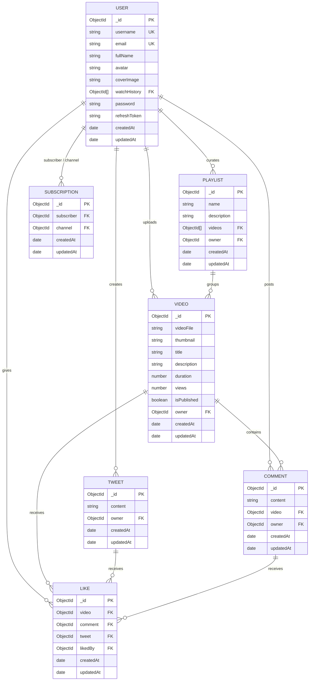
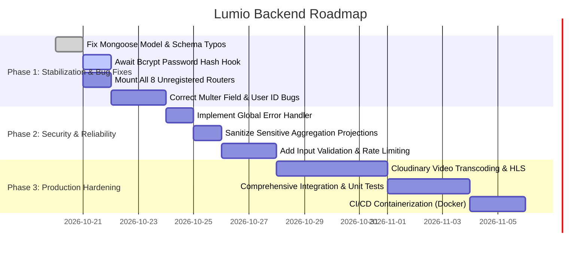

# Product Requirements Document (PRD) & System Specification
## Project: Lumio Backend

---

### Document Control
- **Document Version:** 1.0.0
- **Status:** Approved / Architecture Review
- **Author:** Atul Rajput
- **Target Platform:** Node.js / Express / MongoDB (MERN Stack Backend)
- **Primary Domain:** Video Streaming, Creator Channels, Social Interaction Platform

---

## 1. Executive Summary & Objective

### 1.1 Product Overview
**Lumio Backend** is a production-oriented, scalable RESTful API engine designed for video-sharing and social interaction platforms (similar to YouTube/Twitter hybrid). It provides a full backend foundation for media ingestion, streaming metadata management, creator channel profiles, user engagement (likes, comments, tweets), playlists, channel subscriptions, and creator dashboard analytics.

### 1.2 Core Business Objectives
- **Secure Identity Management:** Provide end-to-end tokenized authentication with dual JWTs (Access and Refresh tokens) stored securely in HTTP-only cookies.
- **Media Ingestion & Cloud Asset Storage:** Leverage local multi-part buffering via Multer and cloud media optimization via Cloudinary.
- **Community Engagement:** Support fine-grained interactions including polymorphic likes (on videos, tweets, comments), nested comments with pagination, channel subscriptions, and short-form community tweets.
- **Creator Tooling:** Real-time analytics dashboard aggregating video views, like totals, and subscriber metrics.

---

## 2. Technology Stack & Architectural Principles

### 2.1 Technology Stack

| Layer | Component | Version / Library | Rationale |
| :--- | :--- | :--- | :--- |
| **Runtime** | Node.js (ES Modules) | `"type": "module"` | Native ECMAScript modularity (`import`/`export`) |
| **Framework** | Express.js | `^5.3.0` | Modern HTTP routing, native async error handling support |
| **Database** | MongoDB | Cloud / Atlas | Flexible schema for media documents and aggregation pipelines |
| **ODM** | Mongoose | `^8.24.5` | Document validation, schema middleware hooks, type safety |
| **Pagination** | mongoose-aggregate-paginate-v2 | `^1.1.5` | Paginates complex multi-stage aggregation pipelines |
| **Auth & Crypto** | JSON Web Token & Bcrypt | `jsonwebtoken ^9.0.3`, `bcrypt ^6.0.0` | Asymmetric payload signing and adaptive salt password hashing |
| **Media Storage** | Cloudinary SDK | `^2.11.0` | Cloud CDN storage for video streaming, avatars, and thumbnails |
| **File Handling** | Multer | `^1.4.5-lts.2` | Disk storage for transient uploads into `./public/temp` |
| **Security & Utilities** | CORS & Cookie-Parser | `cors ^2.8.6`, `cookie-parser ^1.4.7` | Cross-origin resource sharing and HTTP-only cookie parsing |
| **Dev Tooling** | Nodemon & Prettier | `nodemon ^3.1.14`, `prettier ^3.9.10` | Hot-reloading and automated code styling |

### 2.2 System Architecture & Design Patterns

```
                               ┌────────────────────────────────┐
                               │       Client Applications       │
                               │  (Web, Mobile, External API)   │
                               └──────────────┬─────────────────┘
                                              │ HTTP Requests + Cookies
                                              ▼
                               ┌────────────────────────────────┐
                               │        Express Server          │
                               │    (CORS, Parser, Static)      │
                               └──────────────┬─────────────────┘
                                              │
                      ┌───────────────────────┴───────────────────────┐
                      ▼                                               ▼
         ┌─────────────────────────┐                     ┌─────────────────────────┐
         │   Public API Routes     │                     │  Protected API Routes   │
         │ (Register, Login, Ping) │                     │ (verifyJWT Middleware)  │
         └────────────┬────────────┘                     └────────────┬────────────┘
                      │                                               │
                      └───────────────────────┬───────────────────────┘
                                              │
                                              ▼
                               ┌────────────────────────────────┐
                               │      Controllers Layer         │
                               │  (AsyncHandler, Business Logic)│
                               └──────┬──────────────────┬──────┘
                                      │                  │
                ┌─────────────────────┘                  └────────────────────┐
                ▼                                                             ▼
 ┌──────────────────────────────┐                             ┌──────────────────────────────┐
 │     Mongoose Models (ODM)    │                             │   External Cloud Services    │
 │ (User, Video, Tweet, etc.)   │                             │  (Cloudinary CDN Storage)    │
 └──────────────┬───────────────┘                             └──────────────────────────────┘
                ▼
 ┌──────────────────────────────┐
 │       MongoDB Database       │
 │    (Aggregations & BSON)     │
 └──────────────────────────────┘
```

- **Controller-Service-Repository Pattern:** Thin route definitions, robust controllers handling requests wrapped inside `asyncHandler`, Mongoose models governing schema integrity and persistence.
- **Unified Standardized Response Format (`ApiResponse`):** Every response delivers a uniform JSON envelope:
  ```json
  {
    "statusCode": 200,
    "data": {},
    "message": "Operation description",
    "success": true
  }
  ```
- **Unified Custom Error Format (`ApiError`):** Centralized error object holding HTTP status codes, structured error arrays, and stack traces.

---

## 3. Environment & Configuration Specifications

> **Security Note:** Secret keys and environment configurations are maintained in `.env` (git-ignored). Public structure mirrors `.env.sample`.

| Variable | Description | Example / Fallback |
| :--- | :--- | :--- |
| `PORT` | Listening server TCP port | `8000` |
| `MONGODB_URI` | MongoDB Atlas or Local connection URI | `mongodb+srv://<user>:<password>@cluster.mongodb.net` |
| `CORS_ORIGIN` | Allowed Cross-Origin Origins | `*` or `http://localhost:3000` |
| `ACCESS_TOKEN_SECRET` | Secret key for signing short-lived JWTs | High-entropy string |
| `ACCESS_TOKEN_EXPIRY` | Lifetime of access token | `1d` |
| `REFRESH_TOKEN_SECRET` | Secret key for signing long-lived refresh tokens | High-entropy string |
| `REFRESH_TOKEN_EXPIRY` | Lifetime of refresh token | `10d` |
| `CLOUDINARY_CLOUD_NAME`| Cloudinary Cloud Name identifier | `cloud_name` |
| `CLOUDINARY_API_KEY` | Cloudinary API Key | `api_key` |
| `CLOUDINARY_API_SECRET`| Cloudinary API Secret | `api_secret` |

---

## 4. Domain Models & Database Schemas



### 4.1 Schema Details

#### 1. User (`src/models/user.model.js`)
- **Fields:**
  - `username` (String, required, unique, lowercase, trimmed, indexed)
  - `email` (String, required, unique, lowercase, trimmed)
  - `fullName` (String, required, trimmed, indexed)
  - `avatar` (String, Cloudinary CDN URL, required)
  - `coverImage` (String, Cloudinary CDN URL, optional)
  - `watchHistory` (Array of ObjectId references to `Video`)
  - `password` (String, hashed via bcrypt, required)
  - `refreshToken` (String, optional)
  - Timestamps (`createdAt`, `updatedAt`)
- **Hooks & Methods:**
  - `pre("save")`: Hashes password before persistence if modified.
  - `isPasswordCorrect(password)`: Compares candidate password against hashed password.
  - `generateAccessToken()`: Signs payload `(_id, email, username, fullName)` with `ACCESS_TOKEN_SECRET`.
  - `generateRefreshToken()`: Signs payload `(_id)` with `REFRESH_TOKEN_SECRET`.

#### 2. Video (`src/models/video.model.js`)
- **Fields:**
  - `videoFile` (String, Cloudinary CDN URL, required)
  - `thumbnail` (String, Cloudinary CDN URL, required)
  - `title` (String, required)
  - `description` (String)
  - `duration` (Number, video length in seconds from Cloudinary, required)
  - `views` (Number, default `0`)
  - `isPublished` (Boolean, default `true`)
  - `owner` (ObjectId reference to `User`)
- **Plugins:** `mongooseAggregatePaginate`

#### 3. Subscription (`src/models/subscription.model.js`)
- **Fields:**
  - `subscriber` (ObjectId reference to `User`, follower)
  - `channel` (ObjectId reference to `User`, creator being followed)
  - Timestamps (`createdAt`, `updatedAt`)

#### 4. Tweet (`src/models/tweet.model.js`)
- **Fields:**
  - `content` (String, required)
  - `owner` (ObjectId reference to `User`)
  - Timestamps (`createdAt`, `updatedAt`)

#### 5. Comment (`src/models/comment.model.js`)
- **Fields:**
  - `content` (String, required)
  - `video` (ObjectId reference to `Video`)
  - `owner` (ObjectId reference to `User`)
  - Timestamps (`createdAt`, `updatedAt`)
- **Plugins:** `mongooseAggregatePaginate`

#### 6. Like (`src/models/like.model.js`)
- **Polymorphic Fields:**
  - `video` (ObjectId reference to `Video`, optional)
  - `comment` (ObjectId reference to `Comment`, optional)
  - `tweet` (ObjectId reference to `Tweet`, optional)
  - `likedBy` (ObjectId reference to `User`, required)
  - Timestamps (`createdAt`, `updatedAt`)

#### 7. Playlist (`src/models/playlist.model.js`)
- **Fields:**
  - `name` (String, required)
  - `description` (String, required)
  - `videos` (Array of ObjectId references to `Video`)
  - `owner` (ObjectId reference to `User`)
  - Timestamps (`createdAt`, `updatedAt`)

---

## 5. Endpoints & Route Specifications

### 5.1 User Management (`/api/v1/users`)
| Method | Endpoint | Auth | Multer Files | Description |
| :--- | :--- | :--- | :--- | :--- |
| `POST` | `/register` | Public | `avatar` (1), `coverImage` (1) | Registers a new user, hashes password, uploads images |
| `POST` | `/login` | Public | None | Verifies credentials, issues access/refresh tokens in cookies |
| `POST` | `/logout` | `verifyJWT` | None | Clears tokens from DB and removes cookies |
| `POST` | `/refresh-token` | Public (Cookie/Body) | None | Re-issues new access and refresh tokens |
| `POST` | `/change-password` | `verifyJWT` | None | Updates current user password |
| `GET` | `/current-user` | `verifyJWT` | None | Returns authenticated user details |
| `PATCH`| `/update-account` | `verifyJWT` | None | Updates `fullName` and `email` |
| `PATCH`| `/avatar` | `verifyJWT` | `avatar` (1) | Replaces user avatar on Cloudinary and DB |
| `PATCH`| `/cover-image` | `verifyJWT` | `coverImage` (1) | Replaces user cover image on Cloudinary and DB |
| `GET` | `/c/:username` | `verifyJWT` | None | Aggregates channel profile (subscribers count, status) |
| `GET` | `/history` | `verifyJWT` | None | Returns user watch history with populated owner info |

### 5.2 Video Management (`/api/v1/videos`)
| Method | Endpoint | Auth | Multer Files | Description |
| :--- | :--- | :--- | :--- | :--- |
| `GET` | `/` | `verifyJWT` | None | Query, search, sort, and paginate published videos |
| `POST` | `/` | `verifyJWT` | `videoFile` (1), `thumbnail` (1) | Uploads video and thumbnail to Cloudinary, creates video |
| `GET` | `/:videoId` | `verifyJWT` | None | Retrieves video details by ID |
| `PATCH`| `/:videoId` | `verifyJWT` | `thumbnail` (1) | Updates title, description, or thumbnail (owner only) |
| `DELETE`|`/:videoId` | `verifyJWT` | None | Deletes video document (owner only) |
| `PATCH`| `/toggle/publish/:videoId` | `verifyJWT` | None | Toggles video `isPublished` status (owner only) |

### 5.3 Tweet / Community Posts (`/api/v1/tweets`)
| Method | Endpoint | Auth | Description |
| :--- | :--- | :--- | :--- |
| `POST` | `/` | `verifyJWT` | Creates a new community tweet post |
| `GET` | `/user/:userId` | `verifyJWT` | Retrieves all tweets authored by a specific user |
| `PATCH`| `/:tweetId` | `verifyJWT` | Edits tweet content (owner only) |
| `DELETE`|`/:tweetId` | `verifyJWT` | Deletes tweet (owner only) |

### 5.4 Subscription System (`/api/v1/subscriptions`)
| Method | Endpoint | Auth | Description |
| :--- | :--- | :--- | :--- |
| `POST` | `/toggle/:channelId` | `verifyJWT` | Toggles subscription (subscribe/unsubscribe) |
| `GET` | `/subscribers/:channelId` | `verifyJWT` | Retrieves list of subscribers for a channel |
| `GET` | `/subscribed/:subscriberId`| `verifyJWT` | Retrieves list of channels a user has subscribed to |

### 5.5 Like System (`/api/v1/likes`)
| Method | Endpoint | Auth | Description |
| :--- | :--- | :--- | :--- |
| `POST` | `/toggle/v/:videoId` | `verifyJWT` | Toggles like/unlike on a video |
| `POST` | `/toggle/c/:commentId` | `verifyJWT` | Toggles like/unlike on a comment |
| `POST` | `/toggle/t/:tweetId` | `verifyJWT` | Toggles like/unlike on a tweet |
| `GET` | `/videos` | `verifyJWT` | Retrieves all videos liked by authenticated user |

### 5.6 Comment System (`/api/v1/comments`)
| Method | Endpoint | Auth | Description |
| :--- | :--- | :--- | :--- |
| `GET` | `/:videoId` | `verifyJWT` | Fetches paginated comments with owner details for a video |
| `POST` | `/:videoId` | `verifyJWT` | Adds a new comment to a video |
| `PATCH`| `/c/:commentId` | `verifyJWT` | Updates comment content (owner only) |
| `DELETE`|`/c/:commentId` | `verifyJWT` | Deletes comment (owner only) |

### 5.7 Playlist System (`/api/v1/playlist`)
| Method | Endpoint | Auth | Description |
| :--- | :--- | :--- | :--- |
| `POST` | `/` | `verifyJWT` | Creates a new user playlist |
| `GET` | `/:playlistId` | `verifyJWT` | Retrieves playlist by ID with populated video details |
| `PATCH`| `/:playlistId` | `verifyJWT` | Updates playlist name and description |
| `DELETE`|`/:playlistId` | `verifyJWT` | Deletes playlist (owner only) |
| `PATCH`| `/add/:videoId/:playlistId` | `verifyJWT` | Adds a video to playlist |
| `PATCH`| `/remove/:videoId/:playlistId` | `verifyJWT` | Removes a video from playlist |
| `GET` | `/user/:userId` | `verifyJWT` | Fetches all playlists owned by a user |

### 5.8 Creator Dashboard (`/api/v1/dashboard`)
| Method | Endpoint | Auth | Description |
| :--- | :--- | :--- | :--- |
| `GET` | `/stats` | `verifyJWT` | Aggregates channel metrics: views, subscribers, videos, likes |
| `GET` | `/videos` | `verifyJWT` | Fetches all videos uploaded by the channel with pagination |

### 5.9 Healthcheck (`/api/v1/healthcheck`)
| Method | Endpoint | Auth | Description |
| :--- | :--- | :--- | :--- |
| `GET` | `/` | Public | Returns server health status `{ status: "OK" }` |

---

## 6. Codebase Audit, Critical Defects & Actionable Recommendations

During the comprehensive analysis of the repository, several architectural gaps, runtime bugs, and security risks were identified. These must be addressed prior to staging/production deployment:

### 6.1 Architectural Disconnect: Unregistered Routes in `src/app.js`
- **Issue:** In [src/app.js](file:///home/atulrajput/Desktop/video-backend/src/app.js#L40), only `userRouter` is mounted (`app.use("/api/v1/users", userRouter)`).
- **Impact:** Routes for `videos`, `tweets`, `subscriptions`, `likes`, `comments`, `playlists`, `dashboard`, and `healthcheck` are completely inaccessible over HTTP (404 Not Found).
- **Remediation:** Import and mount the remaining 8 routers:
  ```javascript
  import videoRouter from "./routes/video.routes.js";
  import tweetRouter from "./routes/tweet.routes.js";
  import subscriptionRouter from "./routes/subscription.routes.js";
  import likeRouter from "./routes/like.routes.js";
  import commentRouter from "./routes/comment.routes.js";
  import playlistRouter from "./routes/playlist.routes.js";
  import dashboardRouter from "./routes/dashboard.routes.js";
  import healthcheckRouter from "./routes/healthcheck.routes.js";

  app.use("/api/v1/videos", videoRouter);
  app.use("/api/v1/tweets", tweetRouter);
  app.use("/api/v1/subscriptions", subscriptionRouter);
  app.use("/api/v1/likes", likeRouter);
  app.use("/api/v1/comments", commentRouter);
  app.use("/api/v1/playlist", playlistRouter);
  app.use("/api/v1/dashboard", dashboardRouter);
  app.use("/api/v1/healthcheck", healthcheckRouter);
  ```

### 6.2 Authentication & Security Vulnerabilities
1. **Password Hashing Missing `await`:**
   - In [src/models/user.model.js:66](file:///home/atulrajput/Desktop/video-backend/src/models/user.model.js#L66), `this.password = bcrypt.hash(this.password, 10);` assigns an unresolved Promise to `this.password` instead of the hashed string!
   - *Fix:* `this.password = await bcrypt.hash(this.password, 10);`
2. **Sensitive Data Exposure in Aggregations:**
   - In [src/controllers/subscription.controller.js:71](file:///home/atulrajput/Desktop/video-backend/src/controllers/subscription.controller.js#L71) and line 106, `$replaceRoot: { newRoot: "$subscriberDetails" }` replaces the root with the entire user document without projecting away `password` and `refreshToken`.
   - *Fix:* Include `$project: { password: 0, refreshToken: 0 }` prior to unwinding or replacing root.
3. **`auth.middleware.js` Header Parsing & Exception Throwing:**
   - In [src/middlewares/auth.middleware.js:10](file:///home/atulrajput/Desktop/video-backend/src/middlewares/auth.middleware.js#L10), `req.Header("Authorization")` causes `TypeError` (Express request method is lowercase `req.header(...)`).
   - Line 31 throws `ApiError` without `new` (`throw ApiError(...)` instead of `throw new ApiError(...)`).

### 6.3 Critical Runtime Exceptions & Typographical Errors
1. **Mongoose Typo in `video.model.js`:**
   - [src/models/video.model.js:1](file:///home/atulrajput/Desktop/video-backend/src/models/video.model.js#L1) and line 44 use `mogoose` instead of `mongoose`.
   - Line 20 has `url: true` on description (invalid schema property).
2. **Global `json()` Reference Error in `user.controller.js`:**
   - In [src/controllers/user.controller.js:298-300](file:///home/atulrajput/Desktop/video-backend/src/controllers/user.controller.js#L298-L300), `return (res.status(200), json(new ApiResponse(...)))` throws `ReferenceError: json is not defined`.
   - *Fix:* `return res.status(200).json(new ApiResponse(200, user, "Account details updated successfully"));`
3. **Multer File Property Mismatches:**
   - In `updateUserAvatar` and `updateUserCoverImage` ([user.controller.js:304, 334](file:///home/atulrajput/Desktop/video-backend/src/controllers/user.controller.js#L304)), `req.files?.path` is used for single uploads, whereas Multer attaches `req.file.path`.
   - In `publishAVideo` ([video.controller.js:47-53](file:///home/atulrajput/Desktop/video-backend/src/controllers/video.controller.js#L47-L53)), `req.files.video.tempFilePath` is checked, whereas Multer uses `req.files.videoFile[0].path`.
4. **Undefined `req.user_id` in Controllers:**
   - In [like.controller.js:57, 99](file:///home/atulrajput/Desktop/video-backend/src/controllers/like.controller.js#L57) and [playlist.controller.js:112](file:///home/atulrajput/Desktop/video-backend/src/controllers/playlist.controller.js#L112), `req.user_id` is used instead of `req.user._id`.
5. **Array Method Typo in `playlist.controller.js`:**
   - In [playlist.controller.js:116](file:///home/atulrajput/Desktop/video-backend/src/controllers/playlist.controller.js#L116), `playlist.videos.include(...)` throws `TypeError: playlist.videos.include is not a function`. The correct JS method is `.includes(...)`.
6. **Dashboard Parameter Mismatch:**
   - In [dashboard.controller.js:12, 91](file:///home/atulrajput/Desktop/video-backend/src/controllers/dashboard.controller.js#L12), `const { channelId } = req.params;` is expected, but [dashboard.routes.js](file:///home/atulrajput/Desktop/video-backend/src/routes/dashboard.routes.js#L12-L13) defines `/stats` and `/videos` without any `:channelId` parameter. It should extract from `req.user?._id` or route definition should be updated to `/:channelId/stats`.

### 6.4 Missing Global Error Middleware
- Currently, uncaught `ApiError` instances are passed to Express's default HTML error handler.
- A dedicated error-handling middleware (`(err, req, res, next)`) should be registered in `src/app.js` after all routes to return clean JSON envelopes.

---

## 7. Implementation Roadmap & Milestones



### Milestone Deliverables:
- **Phase 1 (Stabilization):** Resolve all runtime crashes, mount complete REST API surface, harmonize Multer file uploads with Cloudinary pipelines.
- **Phase 2 (Security & Hardening):** Add global error-handling middleware, strip credentials from subscription aggregations, introduce express-rate-limit and validator schemas.
- **Phase 3 (Scale & Observability):** Support chunked streaming/HLS transcoding, complete automated test suites (Jest/Supertest), and Docker deployment configs.
